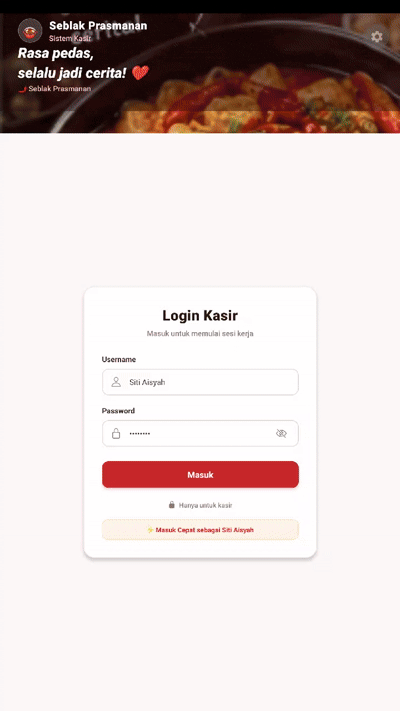

Berikut adalah draf **Laporan Progress Pengembangan Aplikasi Mobile** yang disesuaikan penuh untuk proyek **Kedai Seblak Prasmanan** berdasarkan konteks tugas kelompok dan gambar antarmuka (UI POS) Seblak Prasmanan yang telah disiapkan sebelumnya.

# LAPORAN PROGRESS PENGEMBANGAN APLIKASI MOBILE SEBLAK PRASMANAN

## Tema dan Hasil Wawancara

### 1. Pendahuluan

Pengembangan aplikasi mobile **Seblak Prasmanan POS & Order System** merupakan proyek yang bertujuan untuk mempermudah operasional kasir, pengelolaan variasi topping, perhitungan harga pesanan secara otomatis, pencatatan transaksi, serta penyusunan laporan penjualan harian. Aplikasi ini direncanakan untuk membantu pemilik usaha dan kasir dalam mengelola pesanan kasir (*Point of Sale*) serta memberikan kemudahan bagi pelanggan dalam memilih topping dan metode pembayaran.

Sebagai langkah awal dalam pengembangan sistem, tim telah melakukan wawancara dengan pemilik Kedai Seblak Prasmanan untuk mengetahui proses bisnis yang sedang berjalan, kendala yang dihadapi dalam perhitungan total harga prasmanan, serta kebutuhan terhadap aplikasi yang akan dikembangkan. Hasil wawancara tersebut menjadi dasar dalam menentukan kebutuhan awal dan ruang lingkup pengembangan aplikasi.

### 2. Tujuan Wawancara

Wawancara dilakukan dengan tujuan:

* Mengetahui proses pemesanan dan alur kasir (*Point of Sale*) Seblak Prasmanan yang berjalan saat ini.
* Mengidentifikasi variasi produk (kerupuk, makaroni, sosis, bakso, ceker, telur, sayur, tahu), tingkat kepedasan, dan pilihan kuah.
* Memahami proses penimbangan/pemilihan topping dan mekanisme pembayaran di meja kasir.
* Mengetahui kendala dalam perhitungan total harga serta pencatatan antrean pesanan aktif.
* Mengidentifikasi kebutuhan pemilik, kasir, dan pelanggan terhadap aplikasi mobile.
* Menentukan fitur awal yang perlu diprioritaskan dalam pengembangan sistem.

### 3. Pelaksanaan Wawancara

Wawancara dilakukan dengan pemilik Kedai Seblak Prasmanan sebagai narasumber. Pertanyaan yang diajukan mencakup proses pemilihan topping secara prasmanan, tingkat kepedasan (level 0–5), penentuan harga item, metode pembayaran, pembagian tugas pengguna, dan fitur kasir yang diharapkan tersedia pada aplikasi.

Selain itu, tim juga menggali kendala yang dialami dalam pencatatan pesanan aktif, cetak struk transaksi, pembaruan laporan harian, dan pemantauan riwayat transaksi.

### 4. Hasil Wawancara

Berdasarkan hasil wawancara, diperoleh beberapa informasi mengenai kondisi operasional Kedai Seblak Prasmanan saat ini:

1. **Proses Penjualan:**
* Penjualan dilakukan secara *offline* di mana pelanggan memilih langsung varian topping, tingkat kepedasan, dan pilihan kuah di etalase prasmanan.
* Kasir menginput daftar item yang dipilih pelanggan, memilih nomor meja, lalu menghitung total harga akhir.

2. **Pengelolaan Produk dan Topping:**
* Produk dibagi berdasarkan kategori topping (Kerupuk Rp 1.000, Makaroni Rp 1.000, Sosis Rp 2.000, Bakso Rp 2.000, Ceker Rp 2.000, Telur Rp 1.500, Sayur Rp 1.000, Tahu Rp 1.000), pilihan kuah, serta level pedas (0–5).
* Kendala yang dihadapi adalah sering terjadi antrean panjang di meja kasir karena hitungan manual item prasmanan yang cukup banyak per porsi.

3. **Pemesanan dan Pembayaran:**
* Pelanggan melakukan pemesanan langsung di kasir atau melalui meja pemesanan.
* Metode pembayaran yang disediakan meliputi:
* **Tunai (Cash)** dengan fitur perhitungan kembalian/numpad.
* **QRIS** (pembayaran digital via scan QR).
* **E-Wallet**.

* Setelah pembayaran selesai, sistem menghasilkan **Struk Transaksi** untuk diberikan kepada pelanggan atau sebagai acuan dapur.

4. **Pengguna Sistem:**
* **Owner:** Mengelola laporan penjualan harian/bulanan, melihat grafik riwayat transaksi, serta memantau ringkasan omzet tunai dan non-tunai.
* **Kasir:** Melayani pesanan *Point of Sale*, menginput topping, menghitung total, mengelola status pesanan aktif (Diproses, Siap Bayar, Selesai), dan mencetak struk.

### 5. Kebutuhan Aplikasi

Pemilik menyampaikan bahwa aplikasi diharapkan dapat memberikan kemudahan dalam:

* Antarmuka Kasir (*Point of Sale*) yang cepat dengan tombol kalkulator/numpad internal.
* Pemilihan visual topping, pilihan kuah, dan indikator cabai untuk level pedas.
* Manajemen status pesanan aktif (*Diproses, Siap Bayar, Selesai*).
* Pembuatan dan pencetakan **Struk Transaksi** digital/fisik.
* Penyediaan **Laporan & Riwayat Transaksi** harian yang memisahkan pendapatan Tunai dan Non-Tunai.

---

### 6. Progress Pengembangan Saat Ini

Pada tahap ini, pengembangan aplikasi telah memasuki tahap perancangan antarmuka (UI/UX) dan pembagian komponen *frontend/mobile*:

1. Menyusun alur sistem kasir (*Point of Sale*) Seblak Prasmanan.
2. Mengidentifikasi seluruh item menu, topping, dan level pedas.
3. Merancang modul antarmuka utama:
* Screen Login Kasir
* Dashboard POS Kasir (Pilih Topping, Level Pedas, Ringkasan Pesanan)
* Screen Pesanan Aktif (Filter Status & No. Meja)
* Screen & Modal Pembayaran (Support Tunai, QRIS, E-Wallet + Keypad Numpad)
* Modal Struk Transaksi (*ReceiptModal*)
* Screen Riwayat Transaksi & Laporan Penjualan
4. Membagi modul pengerjaan komponen kepada setiap anggota tim.

### 7. Kesimpulan

Berdasarkan hasil analisis dan rancangan kebutuhan, sistem **Seblak Prasmanan POS** dirancang untuk memangkas waktu transaksi di kasir serta mengotomatisasi perhitungan harga dari kombinasi topping, dan level pedas. Tampilan antarmuka telah disesuaikan agar intuitif digunakan oleh kasir maupun pemilik toko, lengkap dengan laporan transaksi harian terintegrasi.

## Role yang Ada pada Sistem

1. **Owner**
2. **Kasir**

## Pembagian Tugas
1. Shinta PM : Screen Login Kasir, Dashboard POS Kasir (Pilih Topping, Level Pedas, Ringkasan Pesanan), Screen & Modal Pembayaran (Support Tunai, QRIS, E-Wallet + Keypad Numpad), Modal Struk Transaksi (*ReceiptModal*)

2. Maya : Screen Pesanan Aktif (Filter Status & No. Meja),Screen Riwayat Transaksi & Laporan Penjualan

3. Faija :
4. Dewi :

## Bukti Membangun Layer 
Bukti Wawancara:
https://drive.google.com/drive/folders/1QJAz01e1GnNtQZyxFPKLIcbxwteOWv7K

Wireframe Project:
https://www.figma.com/design/MYYuWpDlre1qYXm8VaG1JF/Untitled?node-id=0-1&t=3mO8FJCbHqfOA4Z5-1

